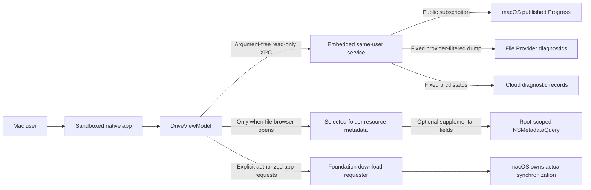

# Architecture

## Scope and current gap

The main requested use case is cancelling downloads already queued by Finder/macOS. That capability is unresolved and unavailable. The current system view corrects an earlier active-record-only presentation; app-owned request controls do not satisfy system queue cancellation.

The native app targets macOS 15 and shares DriveCore/DrivePersistence sources between its canonical Xcode project and SwiftPM fast-test workflow. It uses the existing macOS account with no app authentication, URLSession, CloudKit, CKContainer, document-body processing, server, browser runtime, or third-party runtime dependency.

## Process and data boundaries

System observations and the selected-folder browser have different scopes. A folder bookmark authorizes the latter; it does not scope the helper's account/provider observations or authorize a global mutation.

## Components

| Component | Contract |
|---|---|
| DriveViewModel | Session state, root/scoped access, source-specific observations, action mode, confirmation, and user commands |
| SystemTransfersMonitor | Persistent XPC connection; reads published snapshots every 5s and backlog every 60s; separate in-flight IDs and generation guards |
| SystemActivityMonitor | Supplemental brctl diagnostics, 30s polling, one in-flight request, obsolete-reply guards |
| PublishedTransferRegistry | Main-actor cache of public Progress proxies; stable local IDs until unpublish; public kind only determines direction |
| Status service | Validates enclosing same-user app; exposes argument-free read methods and serializes two internally allowlisted diagnostic commands |
| MetadataMonitor | On-demand progressive background discovery with containment/symlink checks, unknowns retained, optional scoped supplementation |
| FileListQuery | Cancellable detached filtering/sorting and cached UI results; O(1) summaries and empty-selection guards avoid repeated main-thread full-library work |
| DownloadQueue | Session-only app plans/waiting/submitted outcomes, deduplication, two outstanding requests, independent dry-run guard |
| RowHoverController | Passive panels from existing snapshots only; no hover-triggered fetch or action |

## Startup and lifetime

Launch defaults to dry-run. The model restores or obtains a selected-folder bookmark, holds security scope, and starts system observations. **System downloads** is the default view. Detailed file metadata starts only when the user opens a selected-folder browser; connection/refresh alone does not automatically enumerate the library.

Disconnect/root switch stops monitors, invalidates generations, clears the session queue and observations, and releases scope. Quitting never replays requests. The bookmark and Ask each time preference persist; live mode does not. Stale/error observations retain their time and must not be represented as current zero activity.

Initial discovery has no hard timeout. At 60s, a one-time soft notice offers Continue/Cancel. Continue preserves the same pass. Cancel stops app discovery, preserves partial observations/root and optional supplementation, and warns until refresh/new scope. This does not stop iCloud transfers.

## Observation semantics

Provider backlog is one recognized materialization counter in the explicit iCloud provider section. Its logical size describes requested items, not network bytes remaining. Published Progress can represent a whole batch; exact URL/immediate-child subscription semantics do not supply a recursive complete queue inventory. File-kind units are bytes; missing/invalid byte ranges remain unavailable. Unknown public direction is never inferred from localized English text. Cancellation/pausing capabilities are advisory observations, and no such action is exposed.

brctl counts structurally recognized records. Dozens of explicit downloading records cannot be equated with Finder's queued-file count or roughly 300 GB operation. These sources can overlap and are never summed. The [API](api.md) and [FAQ](troubleshooting.md) define their fields.

## Helper boundary and privacy

The main app remains sandboxed. Its embedded helper is unsandboxed, unprivileged, same-user, and requires valid caller code, identifier, effective UID, and the executable path of its enclosing app. It has no installer, administrator prompt, network endpoint, or client-supplied command/path.

The fixed reads are `/usr/bin/brctl status` and `/usr/bin/fileproviderctl dump -l com.apple.CloudDocs.iCloudDriveFileProvider`. The singleton serial worker admits at most one pending read of each kind. Public-progress RPCs use the main run loop, independently of a blocked diagnostic read. NSRunLoop and JoinExistingSession service configuration support Foundation callbacks in the application's audit session.

Each subprocess output has a 128 MiB cap and no hard elapsed-time deadline. Read/output failures can terminate only the owned child, with a one-second kill fallback. Raw output stays in memory, is not logged or returned, and unsupported formats fail unavailable. Aggregate DTOs contain numbers/time; published DTOs additionally contain localized descriptions that can identify private files. Those descriptions remain local, memory-only, and unlogged.

## Actions and distribution

The model shares a live-action decision; the queue independently blocks dry-run dispatch. No/close does no intended work or preference change. Ask each time defaults on; opt-out saves only on Yes. Switching back to dry-run invalidates pending app work, and enabling live never runs plans automatically. Already accepted system transfers cannot be revoked by these controls.

No file eviction, upload forcing, private database access, daemon restart, global queue manipulation, or unverified cancellation is implemented. Local ad hoc universal builds do not establish runtime support on every OS/hardware or public distribution readiness. See [verification](verification.md), [security](security.md), and the [runbook](runbook.md).
