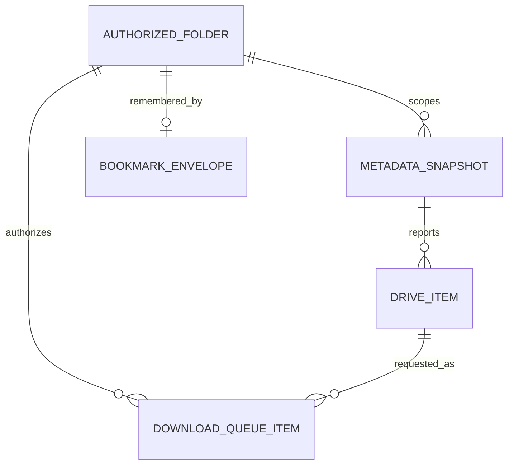
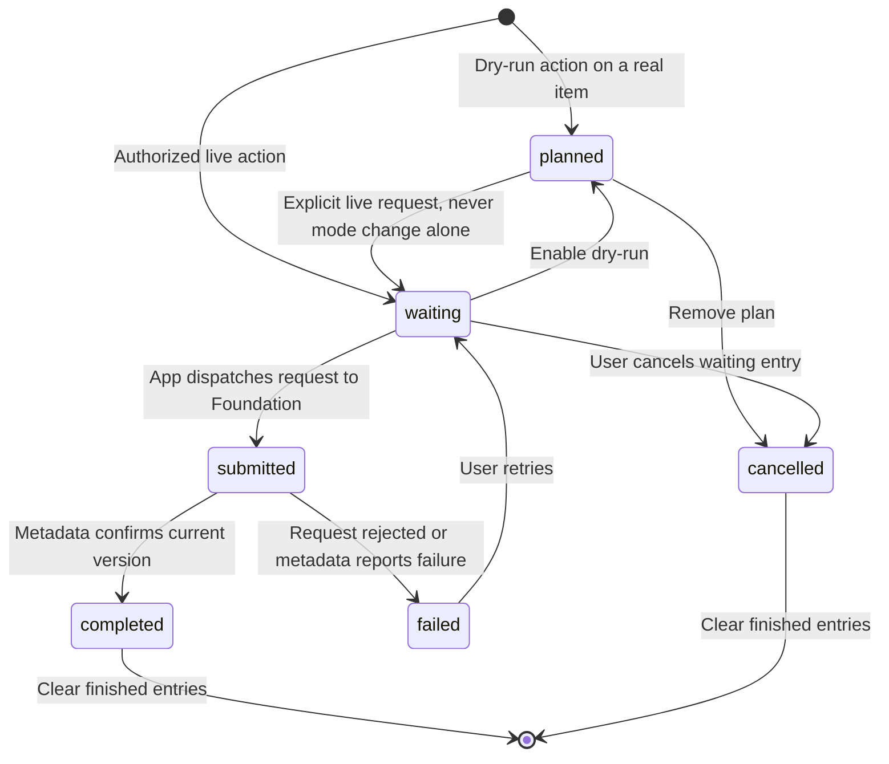

# Data model

## Core entities

| Entity | Fields and meaning | Retention |
|---|---|---|
| Authorized folder | Chosen root URL and security-scoped bookmark | Bookmark persisted until replaced or disconnected |
| Metadata snapshot | Root, observation time, gathering flag, warning, file items | Current session memory |
| Drive item | Stable URL identity, name, relative path, optional bytes/date, sync state, optional progress/issue, directory flag | Current snapshot memory |
| Download queue item | UUID, URL, display name, status, optional error | Current process session |
| Bookmark envelope | Schema version and opaque bookmark data | Local application storage |
| Action mode | Dry-run/live switch, default dry-run | Current app session |
| Confirmation preference | Ask each time Boolean, default true | Local UserDefaults |
| System activity snapshot | Observation time; optional diagnostic item/record counts, pending-upload/downloading counts and logical record bytes | Current app session |
| System backlog snapshot | Observation time; pending materialization item count, requested logical bytes, provider scope | Current app session |
| Published transfer snapshot | Local stable ID until unpublish, observation time, localized descriptions, public kind or unknown, optional file-kind byte counts, advertised capabilities | Current app session |
| Hover presentation | Existing file, request, or navigation snapshot values; no additional metadata fetch | Transient UI memory |

File names and paths may be personal or sensitive even when file contents are never opened. They should not be copied into application logs or diagnostics by default.

Whole-account system activity is a separate scope. Raw local status can contain private metadata, but remains bounded in the helper's memory. Diagnostic DTOs contain aggregate numbers and observation time. Published progress DTOs also contain macOS localized descriptions that can include private names; they stay in local memory and are never logged or persisted. Logical sizes are not remaining transfer bytes, rates, or a complete ordered queue. Backlog, batches, and brctl records can overlap and are never summed. None is a cancellable app-owned queue entity.

## Relationships

These are logical relationships among Swift value types and app state. There is no relational database or SQL migration.

## Synchronization states

| State | Meaning |
|---|---|
| `current` | The local version is the most recent version known to this device |
| `cloudOnly` | macOS reports the item is not downloaded |
| `downloaded` | A local copy exists but metadata reports it is stale |
| `downloading` | An active download is reported |
| `uploading` | An active upload is reported |
| `queued` | A download has been requested but is not reported active |
| `pendingUpload` | macOS reports the item has not finished uploading |
| `conflict` | Unresolved versions are reported |
| `error` | macOS supplies a per-file download/upload error field; shown as Metadata warning, not proof that all transfers failed |
| `unknown` | Available metadata cannot establish a more specific state |

Progress is optional and normalized to `0...1`. Missing progress must remain unknown rather than appear as a fabricated zero or complete transfer. Error/conflict state takes precedence over a reassuring current marker. The classifier and tests define precedence when several flags are reported together.

`DriveItem.issue` carries localized macOS metadata text from the resource/query fields. A message about accessing iCloud is not an app authentication response: the app has no login or account client. App-owned submission failures are recorded separately on queue entries. Whole-account diagnostic aggregates do not replace or populate the selected-file metadata fields.

## App-owned download queue state

This state machine does not represent downloads already queued by Finder/macOS. Cancelling that existing queue remains unresolved and unavailable. Detailed folder items are populated only after opening a file-browser section.

Moving a waiting item changes only the app's submission preference. It cannot reorder Apple's global sync work. A submitted entry cannot be represented as canceled merely because the user removes an entry from a view.

## Persistence and action preferences

Version 1 stores only the selected folder bookmark, with a schema version, in `Application Support/iCloudDriveManager/connection.json` (inside the sandbox container when bundled). The envelope contains `schemaVersion` and opaque `bookmarkData`. Security-scoped bookmarks are opaque capabilities; do not inspect their bytes or embed them in reports. Access uses Apple's [bookmark APIs](https://developer.apple.com/documentation/foundation/url/bookmarkdata(options:includingresourcevaluesforkeys:relativeto:)).

The store accepts its known schema and rejects an unknown future version. No older production schema exists in this new project, so there is no legacy-data conversion. Future schema changes require a backed-up, explicit one-time migration before overwriting an existing artifact. A stale bookmark is renewed through the current authorization flow; unreadable data must not silently broaden access or trigger file operations.

Snapshots contain the selected folder's real metadata. Queue entries and snapshots remain session-only and are never rehydrated into jobs. No library is seeded.

The Ask each time preference is stored separately as UserDefaults Boolean `askBeforeLiveActions`, defaulting to true when absent. Settings can change it directly. A dialog opt-out persists only after Yes; No/close preserves its prior value. Live mode is not persisted: every new app session starts in dry-run.

Dry-run plans are not submitted or completed transfers. A preference change is not authorization to mutate files. See [current policy evidence](xcode.md#current-dry-run-validation).
